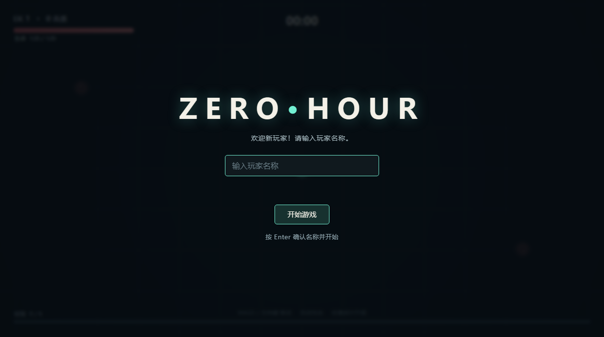
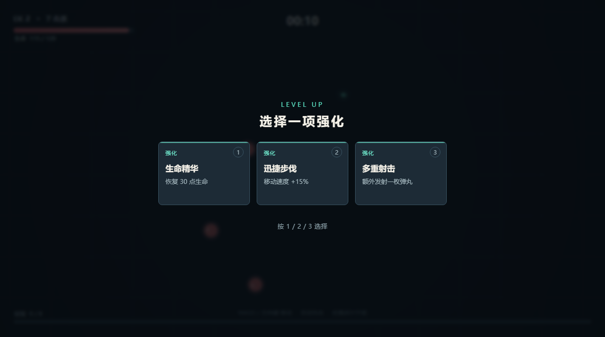
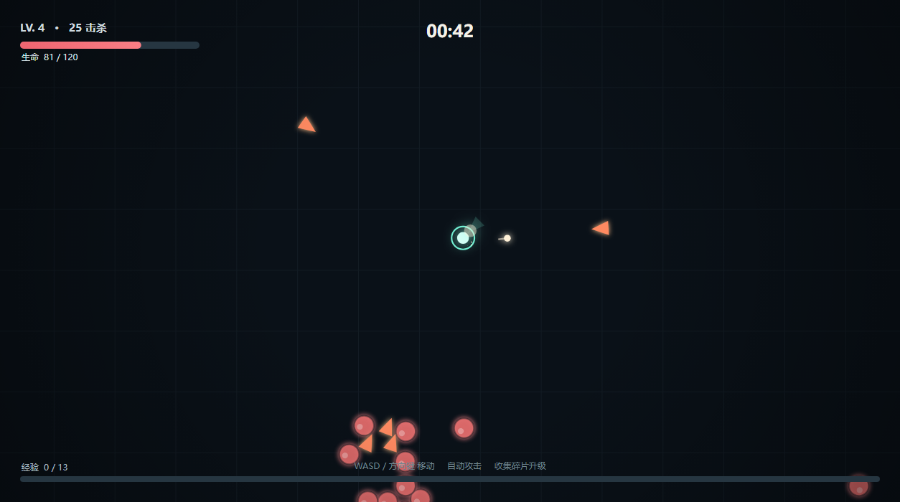
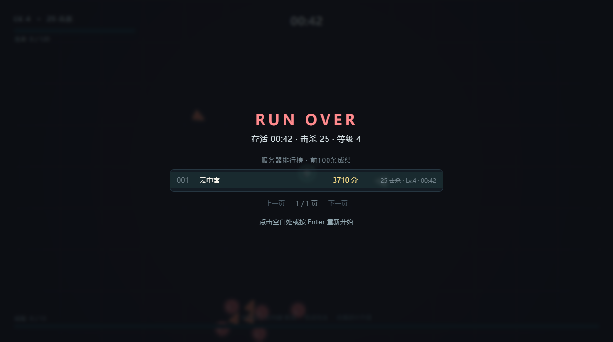

# ZERO HOUR · lite

一个不依赖 Godot 引擎的《ZERO HOUR》复刻版：纯 HTML5 Canvas + 原生 JavaScript，
没有任何构建步骤、没有 wasm、没有第三方库。

原版（8088 端口）是 Godot 4 Web 导出，需要下载 **38 MB 的 wasm + 13 MB 的 pck**
才能真正开始游戏；这个版本的全部资源是 **7 KB 的 HTML + 44 KB 的 JS**，
在服务器上首次加载实测 **~50 ms**，打开即玩。

线上地址：<http://107.174.218.34:8091/>

## 界面

| | |
|---|---|
|  |  |
|  |  |

## 玩法（与原版一致）

- 俯视角自动射击肉鸽：WASD / 方向键移动（移动端左下虚拟摇杆），角色自动攻击最近的敌人
- 击杀敌人掉落经验碎片，靠近会被吸过来；升级时从 3 个强化里选 1 个
- 6 种强化：迅捷步伐（移速 +15%）、锋利弹头（伤害 +25%）、快速装填（攻速 +20%）、
  生命精华（回复 30 点生命）、磁力核心（拾取范围 +35%）、多重射击（多一发弹丸）
- 精英怪、包围圈、随时间递增的刷怪强度
- 死亡后成绩自动上报，排行榜展示前 100 条，分页浏览
- 首次进入需要登记玩家名称（按 IP 隐式识别，不需要账号密码）

## 运行

```sh
PORT=8091 HOST=0.0.0.0 SERVER_DATA_DIR=/var/lib/zero-hour-lite python3 server.py
```

打开 `http://<host>:8091/` 即可。

不需要 `pip install`：只用 Python 标准库。需要 Python 3.10+。

## API

| 方法 | 路径 | 说明 |
|---|---|---|
| GET  | `/api/player` | `{"registered": bool, "name": str}` |
| POST | `/api/register` | `{"name": "1-16 字符"}` |
| POST | `/api/score` | `{"elapsed": 秒, "kills": n, "level": n}` → 分数 = `kills*100 + level*250 + elapsed*5` |
| GET  | `/api/leaderboard` | 前 100 条成绩 |
| GET  | `/api/health` | 存活检查 |

玩家身份是「客户端 IP + 服务端密钥」的 HMAC，与 8088 的原版实现保持一致的思路。

## 文件

```
index.html          页面骨架、HUD 之外的 DOM 界面与样式
js/util.js          数学工具、键鼠/触屏输入、WebAudio 音效
js/world.js         游戏世界：玩家、敌人、子弹、经验、刷怪、强化
js/render.js        Canvas 渲染与 HUD
js/ui.js            界面状态、名字登记、排行榜、网络请求
js/main.js          启动、主循环、状态机
server.py           静态服务 + 排行榜 API（仅标准库）
deploy/             systemd 单元
```

## 部署（systemd）

```sh
install -d /opt/zero-hour-lite /var/lib/zero-hour-lite
cp -r ./* /opt/zero-hour-lite/
chown -R www-data:www-data /var/lib/zero-hour-lite
cp deploy/zero-hour-lite.service /etc/systemd/system/
systemctl daemon-reload
systemctl enable --now zero-hour-lite
```

默认监听 `0.0.0.0:8091`，数据落在 `/var/lib/zero-hour-lite/leaderboard.sqlite3`。

## 说明

- 排行榜数据库与原版（8088，`/var/lib/zero-hour`）**互相独立**，两个版本各记各的成绩。
- 原版的 Godot 项目源码不在服务器上，本版本是按导出的 `.pck` 中的文案、界面、
  规则与排行榜数据还原的功能实现，数值（伤害、速度、刷怪曲线）经过调校以贴近原版手感。
- 音效由 WebAudio 实时合成，按 `M` 静音。
